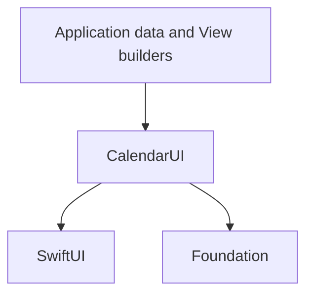

# CalendarUI

## Purpose and Scope
CalendarUI is a headless SwiftUI calendar package for iOS, macOS, watchOS, and tvOS 27 or later. This document owns both the system and SwiftPM package design. Its child is the [CalendarUI module](Sources/CalendarUI/DESIGN.md).

## Responsibilities and Boundaries
The package owns date enumeration, paging, and timeline placement. Applications own event storage, recurrence, scheduling, and the views rendered in calendar cells. There is no required event store or platform UI framework dependency.

## Related Designs
| Design | Relationship | Contract Used | Summary | Cautions |
|---|---|---|---|---|
| [CalendarUI](Sources/CalendarUI/DESIGN.md) | child | View composition API | Implements calendar presentation | Time zone and placeholder migration affect callers |

## Architecture

## Contracts and Invariants
- Minimum deployment versions are 27.0 on all declared platforms.
- Existing calendar view names and event protocols remain available. The unused two-argument DayCalendar placeholder becomes a date-only empty-slot builder; README documents the source migration.
- Public nonthrowing initializers reject invalid ranges and nonpositive intervals with documented preconditions rather than silently changing inputs.
- Calendar calculations use the supplied time zone throughout. Rendering and scroll targets share the timeline's calculation owner.

## Verification and Change Impact
Module behavioral tests own calendar and rendering regressions. Package integration requires native macOS tests and builds for installed Apple SDKs. Source-only compilation for an SDK is not runtime evidence. Recheck platform declarations, demo callers, and README when changing public APIs.

### Verification Record — 2026-11-04

| Requirement | Evidence owner | Result |
|---|---|---|
| Platform support | Package and demo builds | iOS Simulator 27.1, watchOS Simulator 27.0, and tvOS Simulator 27.0 builds succeeded; the iOS demo also built for arm64 Simulator |
| Requested time zone | MonthCalendarTests, DayCalendarTests, CalendarDatesTests | Requested-zone midnight boundaries and complete month grids verified across four zones |
| Complete time sections | WeekCalendarTests | Partial final sections, two-hour minute intervals, and Int.max intervals verified |
| Shared timeline coordinates | TimeCalendarTests | Visible-range coordinates, event clipping, and 23/25-hour days verified |
| Existing scroll anchors | NativeRenderingTests | Actual mounted timelines scroll to current slots with String event IDs and with no events; tests choose a local-noon zone to require scrolling |
| Empty-slot builders | NativeRenderingTests | Empty calendars invoke placeholders; occupied slots render event builders instead |
| Paging and lifecycle | NativeRenderingTests | Programmatic next-day movement and recentering to 2060 retain selection and update mounted content/header |

The final native run passed **15 tests in 6 suites** on macOS 27.0.1 with Swift 6.4.1. The other platform results are compilation evidence; their device interaction was not exercised. Xcode 27.1 requires its default toolchain for manifest resolution in this environment; builds used the explicit Swift 6.4.1 `SWIFT_EXEC` setting for production sources. Every command had an outer timeout. The initial multi-architecture demo build exceeded 120 seconds during SDK module compilation; the bounded arm64 build succeeded. Temporary derived data and the local verification build directory are removed after validation.
