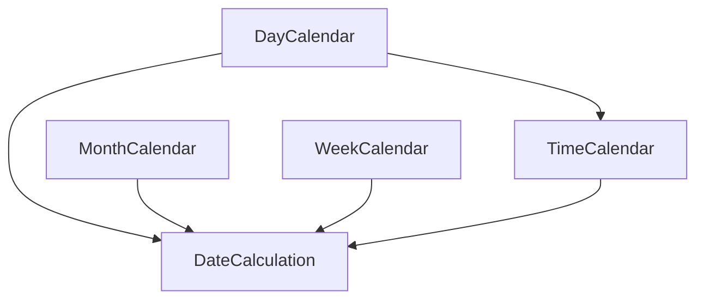

# CalendarUI Module

## Purpose and Scope
This is the package's only production module. Parent: [package](../../DESIGN.md). Children: [DateCalculation](DateCalculation/DESIGN.md), [MonthCalendar](MonthCalendar/DESIGN.md), [WeekCalendar](WeekCalendar/DESIGN.md), [DayCalendar](DayCalendar/DESIGN.md), and [TimeCalendar](TimeCalendar/DESIGN.md).

## Responsibilities and Boundaries
Public SwiftUI views compose application-provided builders. Internal calculation types own date and coordinate invariants. No component acquires application data or runs scheduled work.

## Related Designs
| Design | Relationship | Contract Used | Summary | Cautions |
|---|---|---|---|---|
| [Package](../../DESIGN.md) | parent | Platforms and compatibility | Distribution boundary | Keep demo callers synchronized |
| [DateCalculation](DateCalculation/DESIGN.md) | child | CalendarDates | Shared calendar boundaries | Preserve one time zone per calculation |
| [MonthCalendar](MonthCalendar/DESIGN.md) | child | MonthCalendar | Month cells | Header receives column index |
| [WeekCalendar](WeekCalendar/DESIGN.md) | child | WeekCalendar and Interval | Weekly time cells | Positive intervals only |
| [DayCalendar](DayCalendar/DESIGN.md) | child | DayCalendar | Date binding and empty slots | Date-only placeholder |
| [TimeCalendar](TimeCalendar/DESIGN.md) | child | TimeCalendar and TimeAxis | Events, coordinates, scroll targets | Half-open event periods |

## Architecture

## Contracts and Invariants
Component implementations remain in their owning directories. Calendar and timeline logic is tested through the same internal operations used by production views. Views run on SwiftUI's UI isolation; calculations hold value state only. There are no background tasks, streams, or shared mutable global stores.

## Verification and Change Impact
[Tests](../../Tests/CalendarUITests) cover each component by name. Calendar/time-axis changes require corresponding view integration tests. Platform or public signature changes require the parent design and README to be checked.
